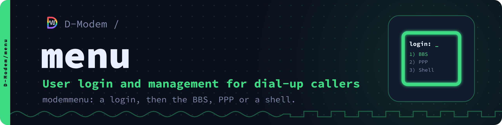

# modemmenu

A login and menu for dial-up callers, the first thing a caller sees once
the modems connect.

modemmenu asks for a user name and password, shows the message of the
day and offers a menu of what the caller may do: a bulletin board, PPP
dial-up networking, a shell, or any program. It runs behind
[D-Modem](https://github.com/D-Modem/D-Modem)'s Asterisk module,
`app_dmodem`, one process per call or one server for all of them.

```
Welcome to D-Modem.

Connected at 33600 bit/s.

login: alice
Password: ******

Hello alice, on 2026-10-10 at 21:05:09.

The line is down for maintenance on Sunday.

Main menu

  [B] Bulletin board
  [P] PPP (dial-up networking)
  [S] Shell
  [G] Goodbye (hang up)

Selection: ppp
```

- Logins from a users file, LDAP, SQL (MySQL/MariaDB, PostgreSQL, SQLite) or system accounts through PAM
- PPP dialers detected (AutoPPP and PAP), with a pppd plugin
- The classic AOL client dialing in: AOLnet, SprintNet and Tymnet played, then the line to a BBS's AOL host
- Menus with access by user and group, guests and self sign-up
- The menu full screen on ANSI and VT terminals (a 90s blue desk, the bar moved with the cursor keys; only what changed is sent, for slow lines), lines for the others
- `modemmenu -setup`: the configuration on full screens with pull-down menus and the sample's help, for the sysop at the console or calling in
- Each item starts with the caller's credentials and the call's details: dialed number, caller ID, connect rate, time
- Drop files for doors, last callers, and handing a caller to another menu
- A ready-made FreePBX setup ([freepbx/](freepbx/README.md))

## Quick start

Go 1.22 or later:

```
make                                                    # with PAM when libpam's headers are there
make install                                            # /usr/local/bin/modemmenu and the samples
modemmenu -config /etc/asterisk/modemmenu.conf -check   # check the configuration
modemmenu -config /etc/asterisk/modemmenu.conf -setup   # or change it on a full screen
```

then point an `app_dmodem` profile at it ([docs/running.md](docs/running.md)).

## Documentation

The documentation is also a website, [d-modem.github.io/menu](https://d-modem.github.io/menu/), with reference pages made from the code.

[docs/](docs/README.md) has building, running, configuration,
authentication, PPP, security and the tests.
[samples/modemmenu.conf.sample](samples/modemmenu.conf.sample) has every option.

## The D-Modem suite

| Repository | What it is |
| --- | --- |
| [D-Modem](https://github.com/D-Modem/D-Modem) | The open V.92 softmodem: dmodemd, libdmodem and the Asterisk, FreeSWITCH and ARI modules |
| [app](https://github.com/D-Modem/app) | The D-Modem app for Android and iOS: a dial-up modem on a SIP call |
| [hardware](https://github.com/D-Modem/hardware) | pico-serial: RP2040 serial adapters and phone-line USB sticks |
| [menu](https://github.com/D-Modem/menu) | modemmenu: the login and menu dial-up callers reach |
| [bbs](https://github.com/D-Modem/bbs) | A bulletin board for telnet, SSH, TN3270 and modem callers |
| [go3270](https://github.com/D-Modem/go3270) | A Go library for 3270 terminal servers, used by bbs |
| [brand](https://github.com/D-Modem/brand) | Logos, colours, type and the naming guide |

## Licence

AGPL-3.0-only ([LICENSE](LICENSE)), or a commercial licence from the D-Modem Authors ([COMMERCIAL-LICENSE.md](COMMERCIAL-LICENSE.md)). Contributions come with a contributor agreement ([CONTRIBUTING.md](CONTRIBUTING.md)).

If you modify modemmenu and offer it to callers, the AGPL's section 13
has you offer them its source: a menu item, the banner or the message of
the day naming where it is will do.
