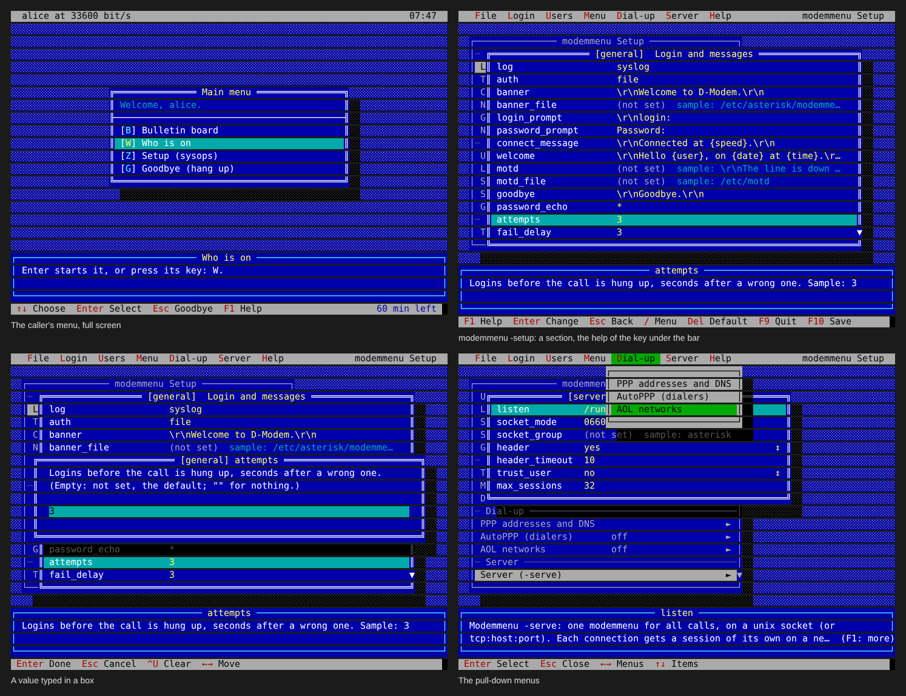

# The sysop's setup

`modemmenu -setup` changes `modemmenu.conf` on a full screen. It looks
like the setup programs of BBSs from the 1990s:

- A menu bar with pull-down menus, on a blue desktop.
- A window for each section. Each window cascades over the window that
  opened it.
- A box below the windows, with the help for the line under the bar.
- A bar at the bottom of the screen, which shows the keys.



```
modemmenu -setup -config /etc/asterisk/modemmenu.conf
```

- The first window shows all sections, under Login, Users, Menu,
  Dial-up and Server. These are the same as the menus of the bar.
  **Enter** opens a section. The section shows its keys and their values.
  If the file does not have a key, the section shows `(not set)` and the
  value from the sample.
- Each section and key has a line under the bar that tells the sysop
  what it does. **F1** adds the notes from the sample and the values that
  you can select.
- **Enter** changes the value under the bar. You type the value in a box
  (cursor keys, Home, End, Del, ^U), or you select it from a list. A `↕`
  at the right of the line shows a list. **Space** moves to the next
  choice. **Del** removes the key, and the key gets its default value
  again. An empty box means "not set". For an empty value, type `""`.
- `[item NAME]` and `[number NAME]` are lists. You can add, open, rename
  or delete an entry. If you rename or delete an item, the setup also
  renames it in `[menu] items` or removes it from `[menu] items`.
  `[groups]` accepts groups with names that the sysop selects.
- **Add a menu item** starts from one of the items in the sample, or
  from an empty item. The sample has these items, and other items: the
  BBS by rlogin or by handoff, PPP, change password, last callers, a
  door, a shell and ZMODEM. The setup fills in the keys of the item and
  adds the item to `[menu] items`. If a different item uses the key of
  the sample, the setup gives the new item a free key.

### Values picked from what there is

For most keys, you select the value from a list. You do not type it.
Each value in the list has a note that tells what it is. For some keys,
the list has the only values that the key accepts. These keys are
`mode`, `tty`, `after`, `charset`, `petscii`, `driver`, `hash`,
`emulation`, `comm_type`, `fullscreen`, `password_change` and all
`yes`/`no` keys. For the other keys, the list has suggestions. To type
your own value, select "Type another value…". A list for more than one
value has checkboxes. **Space** selects a checkbox, and **Enter**
completes the list:

| Key | Offered |
|---|---|
| `[general] auth` | file, ldap, sql, system, checked in the sequence that you select |
| `[menu] items` | each `[item]` with its label and mode, in the menu's order |
| `[item] key` | the letters of the name and label of the item, each marked "free" or "taken by [item x]" / "the hangup" |
| `[item] users`, `[number] user` | the users in the users file |
| `[item] groups`, `[system] groups` | the groups in `[groups]` with their members, and the groups of the system |
| `[item] run_as`, `[authd] allow_users` | `{user}`, and the login accounts of the system |
| `[item] dropfile` | door32.sys, door.sys, dorinfo1.def, dorinfo#.def |
| `[item] path` | the sockets in /run/modemmenu and /run/bbs |
| `[autoppp] item`, `[number] item` | the items of the menu |
| `[server]`/`[authd] listen` | the usual socket, marked "taken by" if the other section uses it |
| `socket_group`, `socket_mode` | the groups of the system, and 0660, 0600, 0666 |
| `[ppp_pool] dns` | the PPP address of this server, the servers in resolv.conf, Cloudflare, Google, Quad9 |
| `[aol] networks` | aolnet, sprintnet, tymnet, p3 |
| time limits, `time_warning`, `min_baud`, `rate`, `security`, `log`... | common values |

- These keys are available:
  - **F1** shows all the help for the line.
  - **/** (or F12, or Alt and a letter) shows the menus.
  - **Esc** goes back one window.
  - **F10** saves.
  - **F9** quits. If there are changes, it asks if you want to save them.
  - `^L` draws the screen again.
- The descriptions are part of the program. The notes from the sample
  are the same as the notes in the [reference](reference.md).

Before the setup saves the file, it checks the file, as
`modemmenu -check` does. If the check fails, the setup saves the file
only when you ask again ("Save anyway").

The file keeps its comments, blank lines and sequence:

- The setup changes a changed key on its own line. It keeps a comment
  after the key.
- The setup adds a new key after the last key of its section.
- The setup adds a new section at the end.

The setup writes the new file next to the old file. Then it renames the
new file to the name of the old file, and keeps the mode and the owner.
Each call reads the file again, thus the next call gets the changes.
modemmenu reads `[server]` when `modemmenu -serve` starts.

If there is no file, the setup starts from the sample and saves the
result at the path of the file.

## On the line

A sysop who calls in can get the setup from the menu, as an item with
`mode = setup`:

```ini
[item setup]
key = Z
label = Setup
mode = setup
groups = sysops
```

The item must have `users` or `groups`. modemmenu refuses the item
without them. A guest can never get this item. The item must have an
ANSI terminal of a minimum of 40x14 (80x24 is better). On other
terminals, modemmenu tells the caller that the terminal is not
applicable.

The idle timeout does not apply to the setup. The setup waits for the
sysop for an unlimited time. But the time limit of the call
(`time_limit`) applies. When the call ends, changes that you did not save
are lost. modemmenu writes the file as the user that it runs as. That
user must be able to write the file.

## Terminals

The setup draws the screens with one of these character sets:

- UTF-8, if the terminal can show it.
- Code page 437, for SyncTERM and the ANSI terminals of BBSs.
- The line-drawing set of a VT (`ESC ( 0`), for a VT or xterm without
  UTF-8.
- ASCII, if the configuration tells it to (`[terminal] charset`).

A real DEC terminal (no colors) gets bold and reverse in place of the
colors. The setup sends only the cells that change. A movement of the bar
uses one or two hundred bytes. At the console, `-setup` gets UTF-8 from
the locale (`LANG`). If the locale does not give UTF-8, it uses the VT
set for `TERM=vt*` or `xterm*`, and code page 437 for `TERM=linux` or
`ansi`.

**See also:** [Configuration](configuration.md#the-full-screen-menu)
